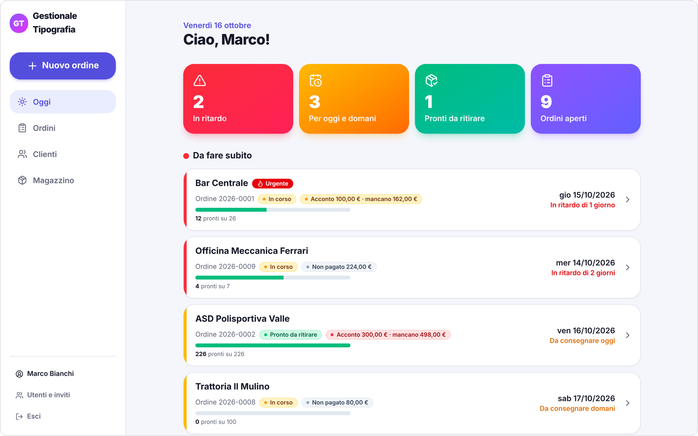

# Gestionale tipografia

[](https://github.com/S6520241/gestionale-tipografia/actions/workflows/ci.yml)

Gestionale web per una piccola azienda di **stampa, tipografia e ricamo**: ordini, clienti, scadenze,
lavorazioni, magazzino e pagamenti, usabile da computer e telefono.

È nato per sostituire fogli Excel e appunti in un'azienda reale del settore, dove ho lavorato per alcuni anni:
il modello dei dati segue il modo in cui il lavoro si svolge davvero in negozio.

> **In English:** a full-stack order management app for a small print & embroidery shop, built with
> Next.js 16 (App Router, Server Actions), TypeScript, Prisma and PostgreSQL. Domain names in the code are in
> Italian on purpose, to match the language of the business.

<!--
Screenshot: aggiungi qui 2-3 immagini fatte con i dati di esempio (npm run db:seed), es.

-->

## Funzionalità

- **Oggi**: la pagina iniziale con ordini in ritardo, da consegnare oggi o domani e pronti da ritirare.
- **Ordini** con numero automatico `anno-progressivo` (es. `2026-0007`), data di consegna, urgenza e note.
  Ogni ordine ha i suoi **prodotti**: colori, taglie e quantità, stampa o ricamo in una o più posizioni, prezzo.
- **Avanzamento di ogni prodotto**: da fare → bozza inviata → bozza approvata → in lavorazione,
  con lo storico di chi ha fatto cosa.
- **Consegne parziali**: pezzi pronti (es. 30 su 50) e ritiri del cliente, anche a più riprese, annullabili.
- **Pagamenti**: acconti e saldo; lo stato (non pagato / acconto / pagato) si calcola da solo.
- **Clienti**: elenco, ricerca, scheda con lo storico degli ordini, archiviazione.
- **Magazzino**: giacenze per colore e taglia, carichi e rettifiche. Un prodotto collegato a un articolo
  scala i pezzi quando passa "in lavorazione".
- **Utenti**: accesso con email e password, nuovi colleghi tramite **codice invito** monouso con scadenza,
  password temporanee e uscita forzata da tutti i dispositivi.

## Tecnologie

| Ambito         | Scelta                                                                                     |
| -------------- | ------------------------------------------------------------------------------------------ |
| Framework      | [Next.js 16](https://nextjs.org) (App Router, React Server Components, Server Actions)     |
| Linguaggio     | TypeScript in modalità `strict`                                                            |
| Database       | PostgreSQL 16 con [Prisma](https://www.prisma.io) (schema e migrazioni)                    |
| Autenticazione | [Auth.js](https://authjs.dev) v5, credenziali + sessione JWT, password con bcrypt          |
| Validazione    | [Zod](https://zod.dev), condivisa tra browser e server                                     |
| Interfaccia    | Tailwind CSS 4, componenti nello stile di [shadcn/ui](https://ui.shadcn.com), icone Lucide |
| Qualità        | Vitest (unit + integrazione su PostgreSQL reale), ESLint, Prettier, GitHub Actions         |

## Scelte progettuali

Le decisioni più importanti, e perché:

- **Gli stati si calcolano, non si salvano.** "Pronto", "ritirato", lo stato dell'ordine e lo stato del pagamento
  derivano da quantità, ritiri e pagamenti ([`src/ordini/calcoli.ts`](src/ordini/calcoli.ts)).
  Così non possono mai contraddirsi.
- **Numeri d'ordine senza doppioni.** Il progressivo annuale si genera con un'unica istruzione SQL atomica
  (`INSERT … ON CONFLICT DO UPDATE … RETURNING`); un test lancia 20 richieste contemporanee e verifica che
  i numeri siano tutti diversi.
- **Concorrenza.** Dove si controlla una quantità e poi si scrive (ritiri, pezzi pronti, modifica dei prodotti)
  l'ordine viene bloccato con `SELECT … FOR UPDATE` fino alla fine della transazione.
- **Il magazzino è un registro di movimenti.** La giacenza è la somma dei movimenti, non un numero sovrascritto:
  ogni variazione resta tracciata e un prodotto scala i pezzi una sola volta.
- **Niente cancellazioni dei dati di business.** Ritiri e pagamenti sbagliati si annullano e restano nello storico;
  un prodotto si elimina solo se non ha ancora storia.
- **Doppia rete di validazione.** Zod controlla i moduli; vincoli `CHECK` e `UNIQUE` nel database bloccano i dati
  incoerenti anche se un controllo nel codice venisse dimenticato.
- **Tipi giusti per soldi e date.** Prezzi in `Decimal` (mai `float`), date di consegna come giorni (`@db.Date`)
  per evitare sorprese con il fuso orario.
- **Sicurezza dell'accesso.** Ogni server action ricontrolla l'utente nel database: disattivare un utente o
  cambiargli la password lo fa uscire subito da tutti i dispositivi. I messaggi di login non rivelano quali
  email sono registrate.

## Avvio rapido

Servono **Node.js 22** e **Docker**.

```bash
npm install
cp .env.example .env          # poi imposta AUTH_SECRET (npx auth secret) e il nome dell'azienda
docker compose up -d          # PostgreSQL in locale
npx prisma migrate deploy     # crea le tabelle
npm run db:seed               # utente iniziale e dati di esempio (facoltativo)
npm run dev                   # http://localhost:3000
```

La guida completa (Windows, uso dal telefono, gestione utenti, problemi comuni) è in [`docs/guida.md`](docs/guida.md).

## Comandi

| Comando                              | A cosa serve                                          |
| ------------------------------------ | ----------------------------------------------------- |
| `npm run dev`                        | Avvio in sviluppo con ricaricamento automatico        |
| `npm run build` / `npm start`        | Build di produzione e avvio                           |
| `npm test`                           | Tutti i test (Vitest)                                 |
| `npm run test:db`                    | Prepara il database separato dei test di integrazione |
| `npm run lint` / `npm run typecheck` | ESLint e controllo dei tipi                           |
| `npm run format`                     | Formattazione con Prettier                            |
| `npm run db:migrate -- --name nome`  | Nuova migrazione dopo una modifica a `schema.prisma`  |
| `npm run db:studio`                  | Prisma Studio, per vedere i dati nel browser          |
| `npm run magazzino:importa`          | Carica un inventario iniziale da JSON                 |
| `npm run utente:crea`                | Crea un utente o reimposta la password (emergenze)    |

## Struttura del codice

Il codice è diviso **per area di dominio**, e ogni area ha gli stessi tipi di file:

| File             | Contenuto                                                          | Dove gira        |
| ---------------- | ------------------------------------------------------------------ | ---------------- |
| `regole.ts`      | logica pura: schemi Zod, calcoli, testi (senza database)           | server e browser |
| `database.ts`    | letture e scritture con Prisma, transazioni e regole di dominio    | solo server      |
| `azioni.ts`      | server action: controllo dell'utente e dei dati, poi `database.ts` | solo server      |
| `componenti.tsx` | componenti di sola visualizzazione                                 | server           |
| `moduli.tsx`     | moduli e controlli interattivi (`"use client"`)                    | browser          |

```
src/
  auth.ts          autenticazione (Auth.js) e utenteCorrente()
  proxy.ts         protezione delle pagine (il "middleware" di Next.js 16)
  comune/          client del database, gestione errori, componenti condivisi
  utenti/          accesso, registrazione, codici invito, password
  clienti/
  magazzino/       articoli, varianti colore/taglia, movimenti
  ordini/          ordini, prodotti, bozze, ritiri, pagamenti, calcoli degli stati
  app/             le pagine (App Router)
prisma/            schema, migrazioni SQL, inventario di esempio
scripts/           seed, import dell'inventario, creazione utenti, setup del database di test
tests/             test delle regole e test di integrazione su PostgreSQL
docs/              guida all'installazione e all'uso
```

Il percorso di una modifica è sempre lo stesso:
**modulo (`moduli.tsx`) → server action (`azioni.ts`) → `database.ts` (regole + transazione) → `revalidatePath`**.

## Test

```bash
npm run test:db   # la prima volta: crea il database gestionale_test e applica le migrazioni
npm test
```

- `tests/regole.test.ts`: stati, pagamenti, magazzino, validazione dei moduli, date — senza database.
- `tests/database.test.ts`: le regole sul **vero PostgreSQL**, tra cui numeri d'ordine richiesti in parallelo,
  ritiri oltre i pezzi pronti, magazzino scalato una sola volta, codici invito, vincoli `CHECK`.

I test di integrazione usano un database separato (`TEST_DATABASE_URL`) perché ne svuotano le tabelle;
se la variabile manca vengono saltati. La CI su GitHub Actions li esegue a ogni push insieme a lint, build e
controllo dei tipi.

## Prossimi passi

- Archivio delle grafiche dei clienti con versioni (già previsto nello schema del database)
- Approvazione della bozza da parte del cliente tramite link
- Gestione dell'IVA negli incassi (oggi gli importi sono senza IVA: `INCASSO_CON_IVA` in `src/ordini/calcoli.ts`)
- Integrazione con la fatturazione elettronica
- Deploy online con backup automatici
